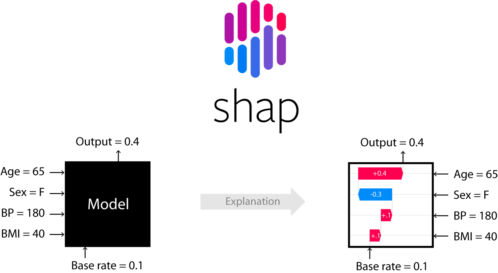

.. SHAP documentation master file, created by
   sphinx-quickstart on Tue May 22 10:44:55 2018.
   You can adapt this file completely to your liking, but it should at least
   contain the root `toctree` directive.

Welcome to the SHAP documentation
---------------------------------

**SHAP (SHapley Additive exPlanations)** is a game theoretic approach to explain the output of
any machine learning model. It connects optimal credit allocation with local explanations
using the classic Shapley values from game theory and their related extensions (see
`papers <https://github.com/shap/shap#citations>`_ for details and citations).

Install
=======

SHAP can be installed from either `PyPI <https://pypi.org/project/shap>`_ or
`conda-forge <https://anaconda.org/conda-forge/shap>`_::

   pip install shap
   or
   conda install -c conda-forge shap

.. _gpu-support:

GPU support
-----------

GPU-accelerated Tree SHAP (:class:`shap.GPUTreeExplainer`) is provided by the
separate ``shap-cuda`` Python package. Install it alongside SHAP using the
``cuda`` extra::

   pip install "shap[cuda]"

This installs both ``shap`` and ``shap-cuda``. Prebuilt wheels avoid compiling the
backend yourself; building from source requires the
`CUDA toolkit <https://developer.nvidia.com/cuda-toolkit>`_.
Use the backend through ``shap.GPUTreeExplainer`` on an NVIDIA GPU
with a compatible driver. See the
`shap-cuda guide <https://github.com/shap/shap/blob/main/backends/shap-cuda/README.md>`_
for prerequisites, local source installation, and a usage example, or read the
`release announcement <https://gcos.ai/blog/shap-cuda-is-now-available/>`_.

.. toctree::
   :maxdepth: 2
   :caption: Introduction

   Topical overviews <overviews>

.. toctree::
   :maxdepth: 2
   :caption: Examples

   Tabular examples <tabular_examples>
   Text examples <text_examples>
   Image examples <image_examples>
   Genomic examples <genomic_examples>

.. toctree::
   :maxdepth: 2
   :caption: Reference

   API reference <api>
   API examples <api_examples>
   Benchmarks <benchmarks>

.. toctree::
   :maxdepth: 1
   :caption: Development

   Release notes <release_notes>
   Contributing guide <contributing>
